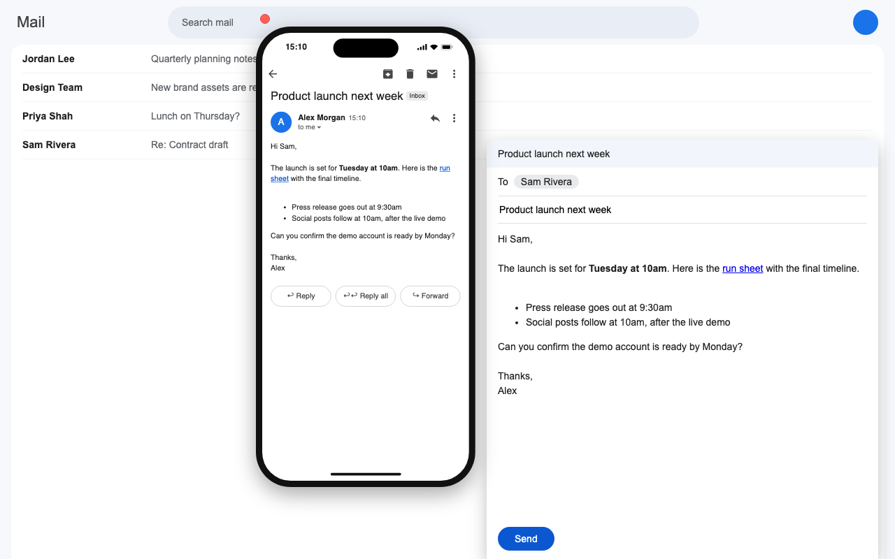

# phoneviewcomposer

A Chrome extension that shows a phone next to the Gmail compose window. The phone shows what the recipient sees on a mobile device, and it updates as you type.

## Install

From the Chrome Web Store: https://chromewebstore.google.com/detail/phoneviewcomposer/dakikebhchppmmbbgobjdbhnifihikeb

From source:

1. Open `chrome://extensions` and turn on Developer mode.
2. Click Load unpacked and select this folder.
3. Reload Gmail.

## Use

- Open a compose window in Gmail. The phone opens on the left of the compose window, on the recipient's inbox.
- Click the message in the phone to open it. Click the back arrow to return to the inbox.
- Drag the phone by the bar above it, the bezel, or the status bar.
- Click the red dot to close the phone. Click the phone button to open it again.

## Files

- `manifest.json`, `content.js`: the extension.
- `icons/`: the extension icon, from Lucide (ISC license, see `icons/LICENSE-lucide.txt`).
- `store/`: Chrome Web Store listing text, screenshots, promo tile, and the demo page that renders them.

## Privacy

The extension runs only on `mail.google.com`. It collects no data and makes no network requests. Privacy policy: https://abhinavmir.xyz/phoneviewcomposeprivacy.html
